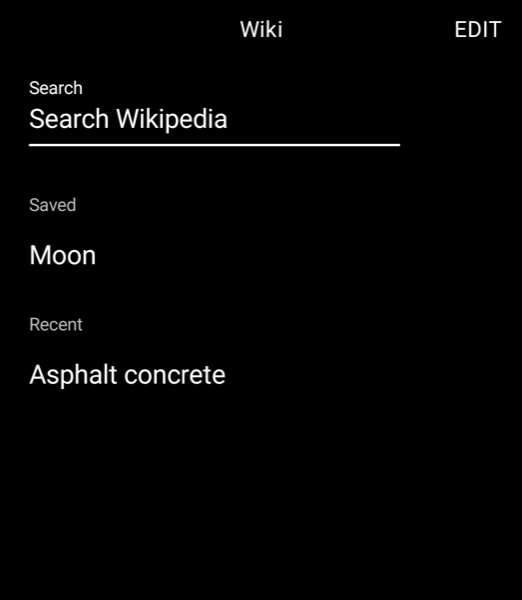
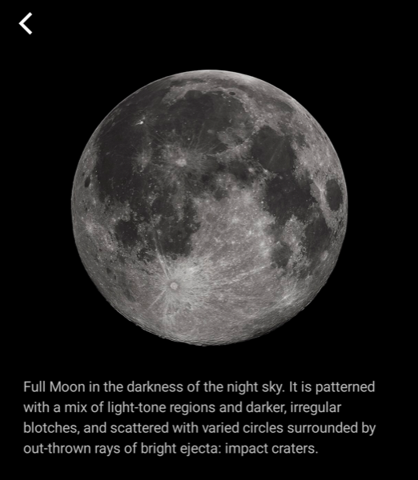

# Wiki for the Light Phone III

A simple, distraction-free Wikipedia reader built as a LightOS tool.

<p>
  
  
  
</p>

## Features

- **Search** English Wikipedia with the LightOS keyboard.
- **Read** articles as clean text: references, tables and navigation boxes are left out.
- **Follow links** to other articles; back returns you to where you were. The search icon in the
  top corner skips all the way back and starts a new search.
- **View images** full screen on request (pinch to zoom, double-tap to reset). Images aren't shown inline.
- **Contents** jumps to any section of a long article.
- **Read offline:** every article you open is stored on the phone. Save the ones you want to keep;
  the 10 most recent unsaved articles are kept too.
- **Remembers your place** in each article.
- **Edit** on the home screen deletes articles from the phone.

## Privacy

Wiki has no accounts, analytics or ads. It only talks to `en.wikipedia.org` (search and article text)
and Wikimedia's image servers (when you open an image). Your search terms go to Wikipedia;
nothing else about you leaves the phone.

## Building

This repo is a copy of Light's [light-sdk](https://github.com/lightphone/light-sdk) with the tool
in [`tool/`](tool). The SDK's own documentation is in [`docs/`](docs).

1. Install Android Studio and open this folder, or build from the command line:

   ```bash
   ./gradlew :tool:assembleDebug
   ```

2. Install on a Light Phone III or an emulator (1080×1240, Android 14, no Google Play) with ADB:

   ```bash
   adb install -r tool/build/outputs/apk/debug/tool-debug.apk
   ```

Run the unit tests with `./gradlew :tool:testDebugUnitTest`.

### Code layout

| File | What it does |
|------|--------------|
| `WikiApi.kt` | Search and article requests to the MediaWiki API |
| `ArticleHtml.kt` | Turns article HTML into headings, paragraphs, lists, links and images |
| `ArticleStore.kt` | On-device storage (Room) for saved and recent articles and reading position |
| `ImageCache.kt` | Downloads and caches images on the phone (up to 40 MB) |
| `*Screen.kt` | The screens: home, search, results, article, contents, image |

### Updating the SDK

```bash
git remote add upstream https://github.com/lightphone/light-sdk.git
git pull upstream main
```

## Credits

Article text and images come from [Wikipedia](https://en.wikipedia.org) and Wikimedia Commons,
available under their respective licenses (text: [CC BY-SA 4.0](https://creativecommons.org/licenses/by-sa/4.0/)).
This project is not affiliated with or endorsed by the Wikimedia Foundation or Light.

Built on the [Light SDK](https://github.com/lightphone/light-sdk). See [LICENSE](LICENSE).
